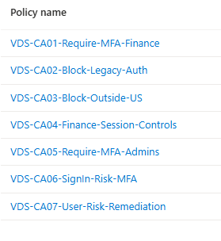
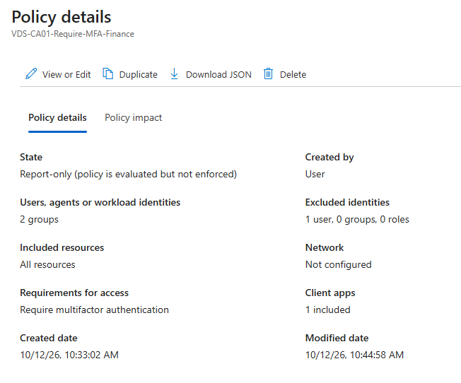
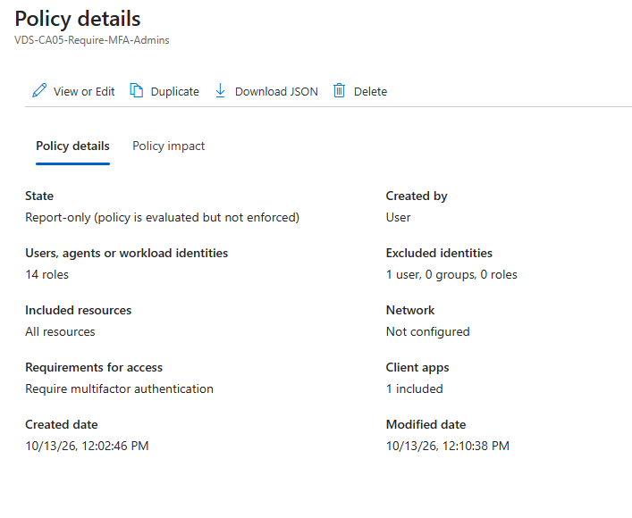
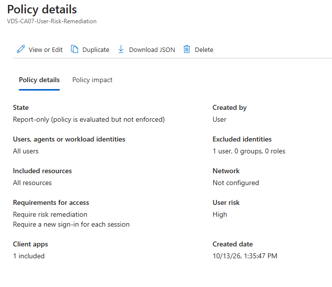

# VDS Conditional Access Framework

*A layered Conditional Access policy framework built in Microsoft Entra ID for a fictional mid-size company (VDS), designed to enforce zero-trust access controls across employee and admin identities.*

---

## Problem Statement

VDS had no consistent access controls in place. Any user could sign in from any location, on any device, using legacy authentication protocols — with no MFA requirement and no session limits. The goal was to design and deploy a Conditional Access framework that enforced least-privilege access, blocked high-risk sign-in paths, and protected privileged accounts — while maintaining a break-glass procedure for emergency access.

---

## What I Built

A framework of 7 Conditional Access policies deployed in Microsoft Entra ID P2, all validated in Report-only mode using the What-If tool and sign-in logs before any live enforcement.

| Policy | Purpose |
|--------|---------|
| CA01 — Require-MFA-Finance | Requires MFA for all Finance employees and managers to protect access to sensitive financial data |
| CA02 — Block-Legacy-Auth | Blocks all legacy authentication protocols, which cannot enforce MFA and are a common attack vector |
| CA03 — Block-Outside-US | Blocks sign-ins from outside the United States to reduce exposure to foreign threat actors |
| CA04 — Finance-Session-Controls | Limits Finance sessions to 4-hour sign-in frequency with no persistent browser sessions |
| CA05 — Require-MFA-Admins | Requires MFA for all administrator accounts regardless of location or device |
| CA06 — SignIn-Risk-MFA | Requires step-up MFA when Entra ID Protection detects a medium or high sign-in risk |
| CA07 — User-Risk-Remediation | Forces password reset when a user account is flagged at high risk by Entra ID Protection |

**Break-Glass Account:** Emergency Access 01 (Global Administrator) is excluded from all 7 policies to ensure emergency access is never blocked by CA enforcement.

---

## Screenshots

### All 7 Policies

### CA01 — Require MFA for Finance

### CA05 — Require MFA for Admins

### CA07 — User Risk Remediation

---

## Tools & Environment

- **Microsoft Entra ID P2** — Identity platform used to configure and manage all Conditional Access policies
- **Entra ID Protection** — Used for risk-based policies (CA06, CA07); provides real-time sign-in and user risk scoring
- **What-If Tool** — Used to validate each policy before enforcement; confirmed correct user targeting and exclusions
- **Sign-in Logs** — Used to verify Report-only policy behavior against real sign-in events
- **Named Locations** — Configured to define US-based access for CA03 geo-restriction
- **Test Users:** Danielle, Kevin, Jill, Alex, Sam, Marcus, and Sarah (fictional VDS employees across Finance and IT-Admin groups)

---

## Key Decisions & Rationale

**Report-only mode for all policies**
All 7 policies were deployed in Report-only mode rather than On. This mirrors real-world practice — enabling live enforcement without a monitoring period risks locking out legitimate users. Each policy was validated using the What-If tool and sign-in logs before any production rollout would be considered.

**Break-glass account excluded from all policies**
Emergency Access 01 holds the Global Administrator role and is excluded from every CA policy. This ensures that if a misconfigured policy blocks all admin access, emergency recovery is still possible. This account is not used for day-to-day administration.

**Security defaults disabled**
Security defaults were disabled to allow Conditional Access policies to take effect. These two controls are mutually exclusive in Entra ID — CA policies require security defaults to be off.

**Risk-based policies layered on top of baseline MFA**
CA06 and CA07 were added after baseline MFA enforcement (CA01, CA05) to handle scenarios where a user's credentials may be compromised. Rather than blocking access outright, CA06 requires step-up MFA on risky sign-ins and CA07 forces password reset on high-risk accounts — balancing security with user productivity.

---

## Next Steps / Planned Improvements

- Move policies from Report-only to On after a 2-week monitoring period with no false positives in sign-in logs
- Add a compliant device requirement to CA01 using Intune device compliance policies
- Expand CA03 geo-restriction to include a named trusted location allowlist rather than a blanket US-only block
- Add a Terms of Use policy for contractors and guest users
- Automate policy documentation using Microsoft Graph PowerShell
